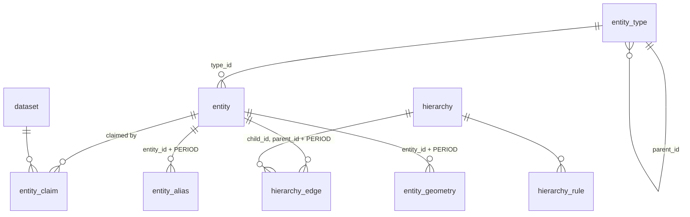

# Data model

Everything is in the `registry` schema. Point-in-time views go in `asof`.

## Tables



| Table | One row is | Key |
|---|---|---|
| `dataset` | a source of rows (a curated folder, a loader, a derivation) with its `priority`; the lowest number wins | `key` |
| `entity_type` | a kind of thing; `is_abstract` types only group subtypes | `code` |
| `entity` | a real-world thing: permanent `id`, unique `key`, `name` and `lifetime` | `id`, `key` |
| `entity_claim` | one dataset's statement that the entity exists: its name and lifetime for that source | `(entity_id, dataset_id)` |
| `hierarchy` | a named tree | `code` |
| `hierarchy_rule` | an allowed (parent type, child type) pair; a NULL parent marks a root; subtypes match | |
| `hierarchy_edge` | "according to `dataset`, during `valid`, `child`'s parent is `parent`" | `(hierarchy_id, child_id, dataset_id, valid WITHOUT OVERLAPS)` |
| `entity_alias` | another system's code for an entity | `(scheme, code, valid WITHOUT OVERLAPS)` |
| `entity_geometry` | a shape: `location`, `boundary` or simplified `display` | `(entity_id, role, dataset_id, valid WITHOUT OVERLAPS)` |

Domain extensions and applications add three kinds of table, all keyed to `registry.entity`:

| Table | One row is | Key |
|---|---|---|
| attribute table, named after its entity type | a version of that type's typed attributes, according to one dataset | `(entity_id, dataset_id, valid WITHOUT OVERLAPS)` |
| relation table | a typed relation that a tree can't hold (a line's two ends, ownership shares) | its entity columns, `dataset_id` and `valid WITHOUT OVERLAPS` |
| code table | a reference list, such as generation technologies | `code` |

## Time

Every fact has a half-open `tstzrange`, `[from, to)`. A change closes the current version and opens a new one; nothing is overwritten. An entity's facts must lie within its `lifetime`, and `PERIOD` foreign keys enforce that.

`registry.as_of()` is the instant that point-in-time reads use. It reads the session setting `combu.as_of` and defaults to now:

```sql
SET combu.as_of = '2019-06-01';                       -- for the session
SELECT set_config('combu.as_of', '2019-06-01', true);  -- for the transaction
```

Plain dates are read in the session's time zone, so set `TIME ZONE` to the market's zone for local days.

## Several sources

- **One entity per thing.** A source finds an existing entity through an alias or its key, and claims or references it rather than creating a duplicate.
- **Each dataset keeps its own versions.** `dataset_id` is part of every fact's key except an alias's. Datasets don't constrain each other.
- **Priority decides what readers see.** `registry.hierarchy_edges(h, ts)` takes each child's edge from the highest-priority dataset in force. The `asof` views do the same for attribute tables. A lower-priority source fills the periods a better one doesn't cover.
- **An alias means one entity at a time**, whichever dataset says so.

!!! note "Not in the extension yet"
    Two parts of the model are still done by the first application's client code. They move into the extension in the next releases (see the [roadmap](roadmap.md)):

    - **Resolving claims:** setting an entity's `name` from the top-priority claim and its `lifetime` to the union of its claims.
    - **Generating the `asof` views** and the type-check triggers on attribute and relation tables.

    Until then, a client that writes claims directly must keep `entity.name` and `entity.lifetime` consistent with them itself.

## What the database guarantees

| Rule | Enforced by |
|---|---|
| A dataset's versions of the same fact don't overlap | temporal primary keys `(…, dataset_id, valid WITHOUT OVERLAPS)` |
| One parent at a time per hierarchy and dataset | the `hierarchy_edge` primary key |
| A fact exists only while its entities exist | `FOREIGN KEY (x_id, PERIOD valid) REFERENCES registry.entity (id, PERIOD lifetime)` |
| An external code means one entity at a time | the `entity_alias` primary key |
| No entities of abstract types | trigger `entity_check` |
| Parent and child types follow the hierarchy's rules; no cycles, even across datasets | deferred constraint trigger `edge_check` |
| Typed references in attribute and relation tables | `registry.require_type()`, attached by a `type_check` trigger to each such table |

The temporal foreign keys and the edge check are deferrable, so a writer can insert related rows in any order inside a transaction.

## Hierarchies

A hierarchy answers "what does this belong to?", with one answer at a time per source. "What is it connected to or shared with?" is a relation. Ask for an ancestor **by type**, never by depth, so inserting a level breaks nothing:

```sql
SELECT registry.entity_ancestor(id, 'admin', 'region', '2019-01-01')
FROM registry.entity WHERE key = 'cl.commune.chillan';
```
